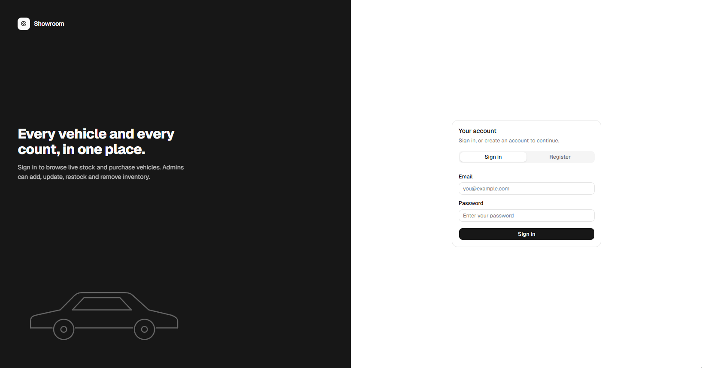
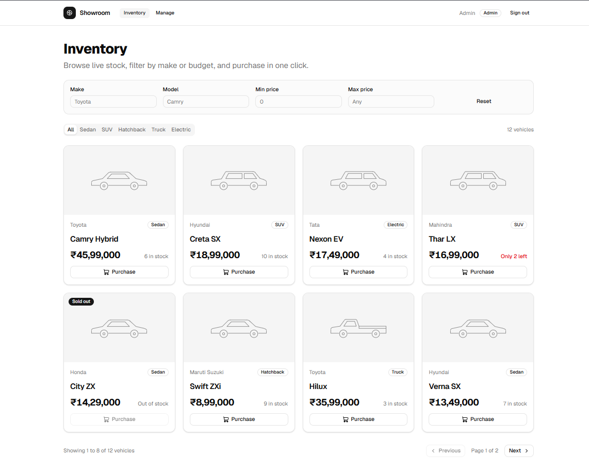
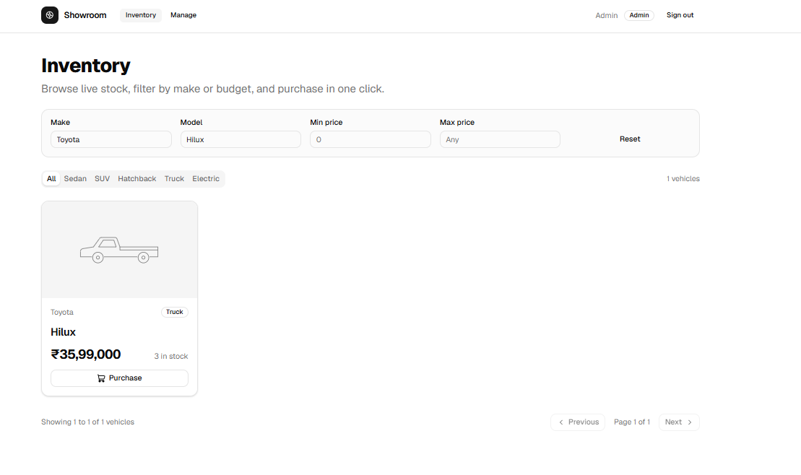
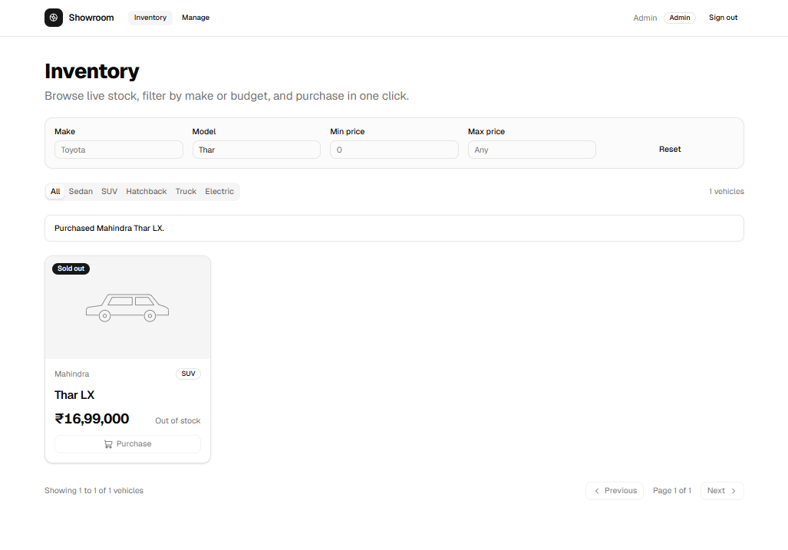
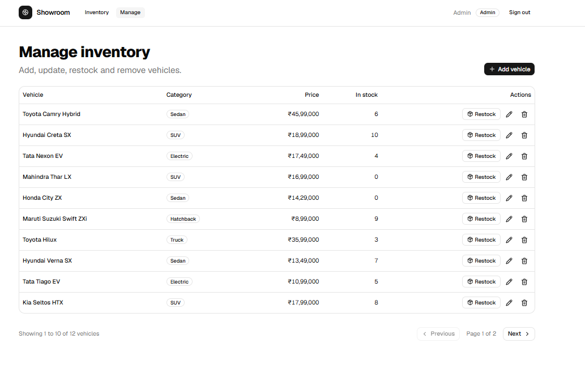
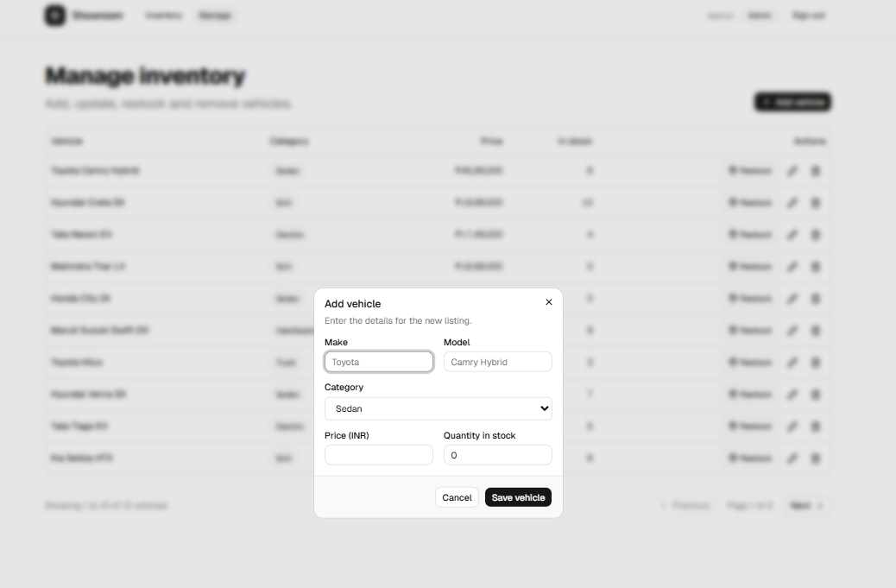

# Car Dealership Inventory System

A full-stack inventory system for a car dealership, built test-first (TDD) 

**Live demo:** https://car-dealership-inventory-h463.onrender.com
(Hosted on a free tier. If it has been idle, the first load can take about a minute while the server wakes up.)

**Demo admin login:** `admin@example.com` / `YourPassword123`

## What it does
- Register and log in with JWT authentication.
- Browse the inventory with search (make, model), category tabs, price range filters and pagination.
- Purchase a vehicle. Stock drops by one, and the button is disabled when stock reaches zero.
- Admins can add, edit, restock and delete vehicles.

## Tech stack
| Layer | Choice |
| --- | --- |
| Backend | Node.js, Express, TypeScript |
| Database | PostgreSQL (Neon) with Prisma ORM |
| Auth | JWT (jsonwebtoken), bcrypt password hashing |
| Tests | Jest, ts-jest, Supertest |
| Frontend | React, TypeScript, Vite, Tailwind CSS, shadcn/ui |
| Hosting | Render (single service serves API and built frontend), Neon |

## API
All `/api/vehicles` routes need `Authorization: Bearer <token>`.

| Method | Route | Access |
| --- | --- | --- |
| POST | `/api/auth/register` | public |
| POST | `/api/auth/login` | public |
| GET | `/api/vehicles` and `/api/vehicles/search` | any signed-in user (`page`, `limit`, `make`, `model`, `category`, `minPrice`, `maxPrice`) |
| POST | `/api/vehicles` | any signed-in user |
| PUT | `/api/vehicles/:id` | any signed-in user |
| DELETE | `/api/vehicles/:id` | **admin only** |
| POST | `/api/vehicles/:id/purchase` | any signed-in user |
| POST | `/api/vehicles/:id/restock` | **admin only** |

List responses look like `{ data, page, limit, total, totalPages }`.

## Run it locally
You need Node 20+ and a PostgreSQL database (a free [Neon](https://neon.tech) project works).

### Backend
```bash
cd backend
npm install
cp .env.example .env        # then fill in DATABASE_URL and JWT_SECRET
npx prisma migrate deploy
npm run create-admin -- admin@example.com YourPassword123
npm run seed                # optional: 12 sample vehicles
npm run dev                 # http://localhost:3000
```

### Frontend
```bash
cd frontend
npm install
npm run dev                 # http://localhost:5173 (proxies /api to the backend)
```

### Tests
```bash
cd backend
npm test
```

## Screenshots
| | |
| --- | --- |
|  |  |
|  |  |
|  |  |

## Design decisions
- **Dependency inversion.** Services depend on repository interfaces. Tests use in-memory fakes, and production uses Prisma implementations, so the business logic is tested without a database.
- **Atomic purchases.** Stock is decremented with a single conditional update (`quantity >= amount`), so two simultaneous buyers can never push stock below zero.
- **Pagination everywhere** on the list endpoint, with an upper bound on page size.
- **One deployable.** The Express server serves the built React app, so there is a single URL and no CORS configuration.

## Test report


The full output is in [`backend/test-report.txt`](backend/test-report.txt). Backend tests were written first (red), then the implementation (green), then refactored; the git history shows the red, green and refactor commits separately. Prisma repositories and server start-up are excluded from coverage because they only talk to the real database.

**Limitation:** the frontend has no automated tests. The kata's TDD focus was the backend, and I verified the UI manually.

## My AI Usage
**Tools used:** Claude (Anthropic), through chat and Claude Code.

**How I used it:**
- Planning the stack and the scope for a one-day deadline, including what to cut (Redis and Kafka).
- Guiding me through the TDD cycle step by step: which failing test to write first, then the minimal code to pass it.
- Generating the first versions of the backend services and the React components, and a design mockup for the UI.
- Debugging environment problems, such as Prisma version mismatches, stray `node_modules`, and a stale `.env` on a running server that caused slow queries.
- Drafting this README.

**What I did myself:** typed or pasted all code into my own repository, ran every test and command, set up the Neon and Render accounts, took the screenshots, and tested the app in the browser. Where the AI's suggestions broke (for example Prisma 7 and TypeScript 7 incompatibilities), I diagnosed the errors and pinned working versions.

**Commits:** every AI-assisted commit carries a `Co-Authored-By: Claude` trailer. 

